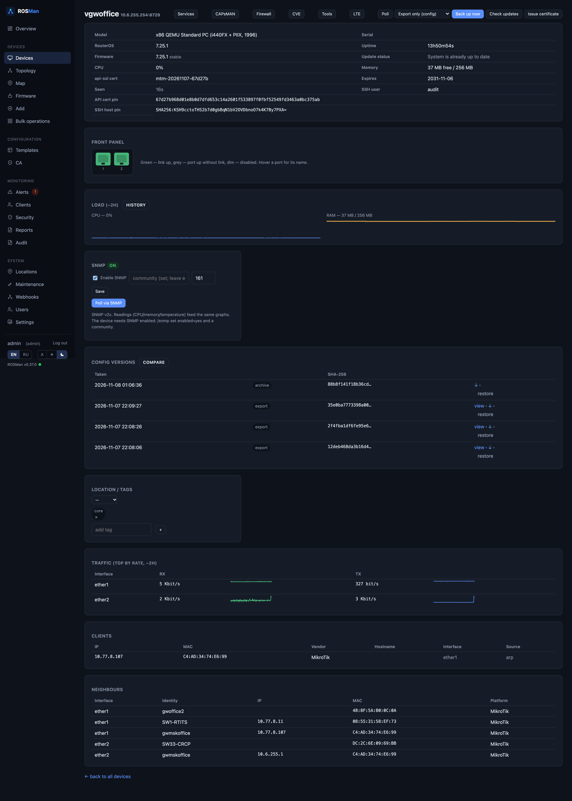
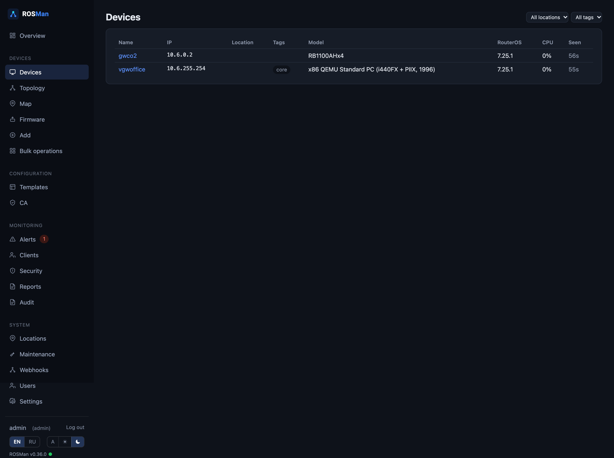
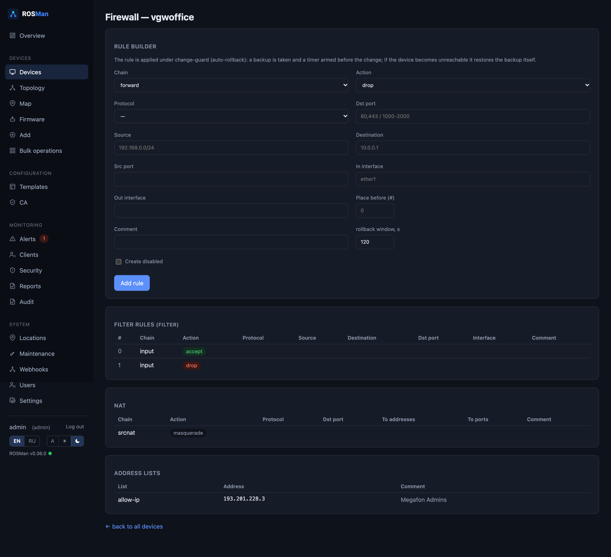
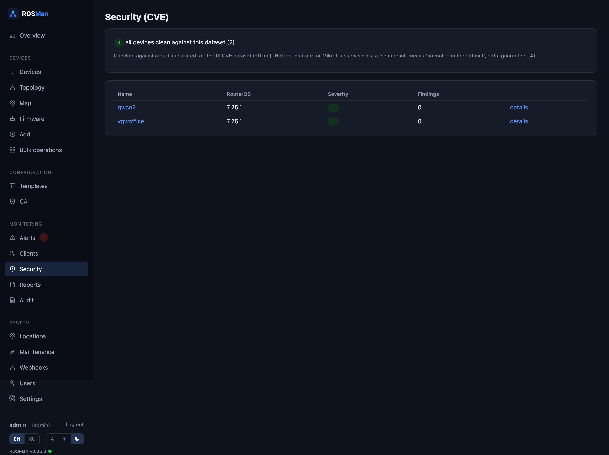

# ROSMan

**A lightweight fleet manager for MikroTik (RouterOS).** One Go binary + SQLite,
no external services. Original project — not affiliated with MikroTik.

The UI language is **English by default**, with Russian available in one click.
Localization lives in plain JSON files under
[`internal/i18n/locales`](internal/i18n/locales) (`en.json`, `ru.json`).



## Features

- **Inventory & onboarding** — add a device over API-SSL with trust-on-first-use
  certificate pinning; identity/model/serial/version read automatically. Bulk
  **import from CSV**.
- **Monitoring** — health polling (CPU/RAM/temperature/uptime), live load graphs
  with selectable ranges (6h/24h/7d/30d), device faceplate, interface traffic,
  connected clients (with OUI vendor lookup), LLDP/MNDP neighbours, topology map,
  and a **geographic map** (Leaflet) of geotagged locations.
- **Configuration** — `/export` + full binary backups over SSH, versioned by
  sha256, with **diff & rollback** under an auto-rollback change-guard; config
  templates; a **firewall viewer and rule builder**; scheduled **export to a git
  repository**.
- **Firmware & security** — update checks, canary-first fleet upgrades, an offline
  **CVE scanner** against RouterOS versions, and per-device **CA / api-ssl**
  certificate management.
- **Services** — read-only views of DNS/DHCP/NTP and classic **CAPsMAN**;
  per-device **ping & traceroute**; **LTE** signal metrics.
- **Operations** — **bulk operations** across selected devices (poll / backup /
  firmware check / apply template), **maintenance windows** that suppress alert
  notifications, and fleet **reports** (CSV + a printable PDF view).
- **Alerting & integrations** — device-down / firmware / certificate alerts via
  Telegram and email, outgoing **webhooks** (JSON, optional HMAC signatures), and
  a Prometheus **`/metrics`** endpoint.
- **Access & accounts** — roles (viewer / operator / admin), **TOTP 2FA**,
  personal **API tokens** with a read-only JSON API, user management, and an audit
  log.
- **Self-update** — the version badge in the corner is green when you run the
  latest release and red when an update is available; an admin installs it from
  Settings → *ROSMan update* (the release binary is downloaded from GitHub,
  checked against the release `SHA256SUMS`, swapped in place and the service
  restarts itself; the previous binary is kept as `rosman.prev`). The service
  user needs write access to the directory holding the binary.
- **Status bar** — a footer line shows what the server is doing right now (fleet
  poll, backups, bulk onboarding, upgrades, adding a device…) with a progress
  bar, so a long operation is never mistaken for a hang.
- **Backup schedule** — a fleet-wide backup period (Settings, default
  `ROSMAN_BACKUP_INTERVAL`) with a per-device override (1 day … 1 year) on the
  device page; the device list shows the last backup and flags it red when it
  is older than the device's period (or 30 days by default).
- **Syslog collector** — ROSMan listens on UDP (default port 5514, Settings →
  Syslog) and stores device logs. One click on a device page (or a bulk action
  on the device list) creates a remote logging action `rosman` on the device
  and rules for the chosen topics. The **Device log** page filters by device,
  severity, period and text, summarises messages per device, lists the most
  repeated ones and exports CSV. Only known device addresses are accepted;
  messages are kept 14 days by default.
- **Critical log alerts** — a critical message in a device's log raises a
  `log_critical` alert (dashboard card, alert list, notifications); it clears
  after 6 quiet hours or by hand.
- **AI analysis** — with an Anthropic API key (Settings → AI) the "Analyse with
  AI" button sends a device's log and facts to Claude and stores a report:
  causes, evidence and proposed RouterOS commands. Nothing is applied.
- **MCP server** — `/mcp` (Bearer API token) exposes read-only tools to AI
  clients: `list_devices`, `get_device`, `get_logs`, `log_summary`,
  `get_alerts`, `get_config`. `rosman mcp https://host:port` is a stdio bridge
  for Claude Code / Claude Desktop that pins the self-signed certificate
  (`ROSMAN_TOKEN`, `ROSMAN_CERT_PIN`; ready-made commands on the Account page).
- **Server panel** — the dashboard shows the host (hardware, CPU load, memory,
  disk, temperature, uptime) and what ROSMan itself takes: process memory,
  database, stored backups, device logs, data directory.
- **Command on a device** — operators run a RouterOS command on one device
  straight from the device list and see its output (audited).
- **Per-device alerts** — a device's own temperature threshold and its own
  Telegram recipients (a group or users) on top of the global ones.
- **Topology symbols** — routers, switches and Wi-Fi access points are drawn
  with their usual network symbols.
- **Hints** — button hints appear after a hover delay each user sets on the
  Account page (default 2.5 s).
- **NetBox sync** — with a NetBox URL and API token (Settings → NetBox) every
  device is mirrored one way, ROSMan → NetBox: matched by serial, IP or name,
  or created with manufacturer, type, role, platform, site, interface and
  primary IP. Devices that already existed in NetBox only get empty fields
  filled and a `rosman` tag; nothing is deleted.
- **Panel editor** — drag tiles, separators and whole lines; select several
  tiles (Ctrl/⌘-click, Shift-click, a line handle) and move them together;
  any number of separators per line.

Credentials are encrypted at rest (AES-256-GCM); passwords are bcrypt-hashed.

## Build

```bash
go build -o rosman ./cmd/rosman
```

## Run

```bash
ROSMAN_SSH_KEY=~/.ssh/id_routeros ./rosman
```

On first start it creates a `./data` directory (database, encryption key,
self-signed TLS) and an `admin` user with a random password printed once to the
log. Open `https://<host>:8443` (accept the self-signed certificate warning).

## Environment variables

| Variable | Default | Purpose |
|---|---|---|
| `ROSMAN_LISTEN` | `:8443` | HTTPS listen address |
| `ROSMAN_DATA_DIR` | `./data` | data directory |
| `ROSMAN_SSH_KEY` | — | SSH private key for `/export` (backups disabled without it) |
| `ROSMAN_POLL_INTERVAL` | `2m` | health poll cadence |
| `ROSMAN_BACKUP_INTERVAL` | `12h` | config backup cadence |
| `ROSMAN_API_TIMEOUT` / `ROSMAN_SSH_TIMEOUT` | `15s` | timeouts |

## JSON API

Create a personal token under **Account**, then:

```bash
curl -k -H "Authorization: Bearer <token>" https://HOST:8443/api/v1/devices
```

Endpoints: `/api/v1/devices`, `/api/v1/devices/{id}`, `/api/v1/alerts`,
`/api/v1/security`, and `/metrics` (Prometheus, same bearer token).

## Screenshots

| Fleet | Firewall | Security (CVE) |
|---|---|---|
|  |  |  |

## Deployment

A ready-made systemd unit is in [`deploy/rosman.service`](deploy/rosman.service).
Deploy the release binary under a dedicated `rosman` user:

```bash
# 1. service user + directories
sudo useradd -r -m -d /home/rosman -s /bin/bash rosman   # skip if the user exists
sudo install -d -m755 -o rosman -g rosman /opt/rosman
sudo install -d -m700 -o rosman -g rosman /opt/rosman/data

# 2. latest release binary (pick your OS/arch asset)
sudo curl -fsSL -o /opt/rosman/rosman \
  https://github.com/BorisGB2001/rosman/releases/latest/download/rosman_linux_amd64
sudo chmod +x /opt/rosman/rosman && sudo chown rosman:rosman /opt/rosman/rosman

# 3. SSH key ROSMan uses to pull RouterOS /export backups (kept in the data dir
#    so the full-backup archive includes it); import the .pub onto each device
sudo -u rosman ssh-keygen -t ed25519 -N '' -f /opt/rosman/data/routeros_id_ed25519

# 4. service
sudo cp deploy/rosman.service /etc/systemd/system/rosman.service
sudo systemctl daemon-reload && sudo systemctl enable --now rosman
sudo journalctl -u rosman | grep 'initial admin'   # the one-time admin password
```

Then open `https://<host>:18443` and sign in as `admin` with that password.
Build from source instead of a release binary with `go build -o rosman ./cmd/rosman`.

---

### Русский

ROSMan — лёгкий менеджер парка MikroTik (RouterOS): один Go-бинарник + SQLite, без
внешних сервисов. Интерфейс по умолчанию на английском, русский — в один клик
(локализация в JSON-файлах `internal/i18n/locales`). Полный список возможностей —
выше в английском разделе; архитектура и история — в [DESIGN.md](DESIGN.md).
