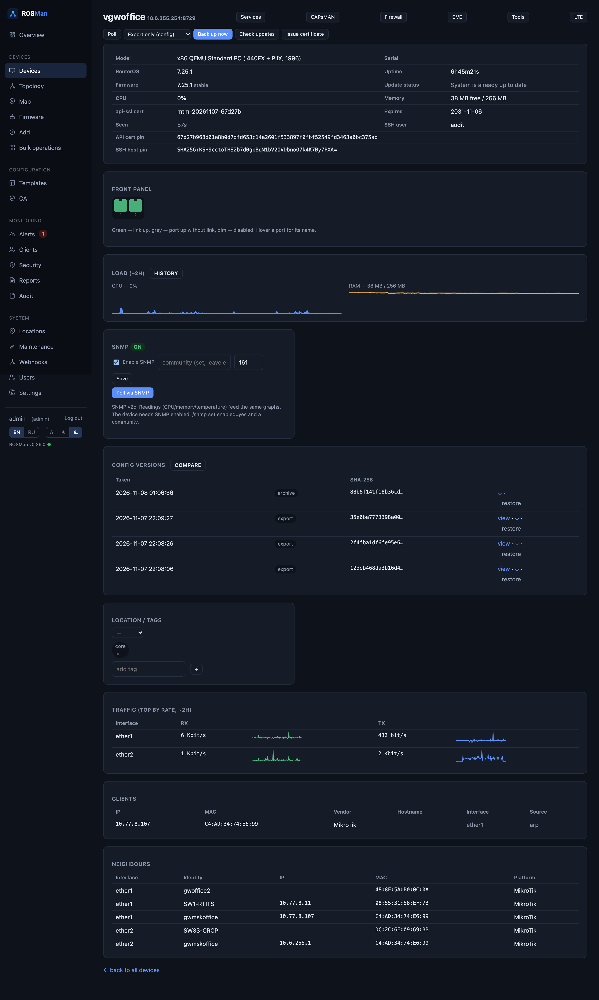
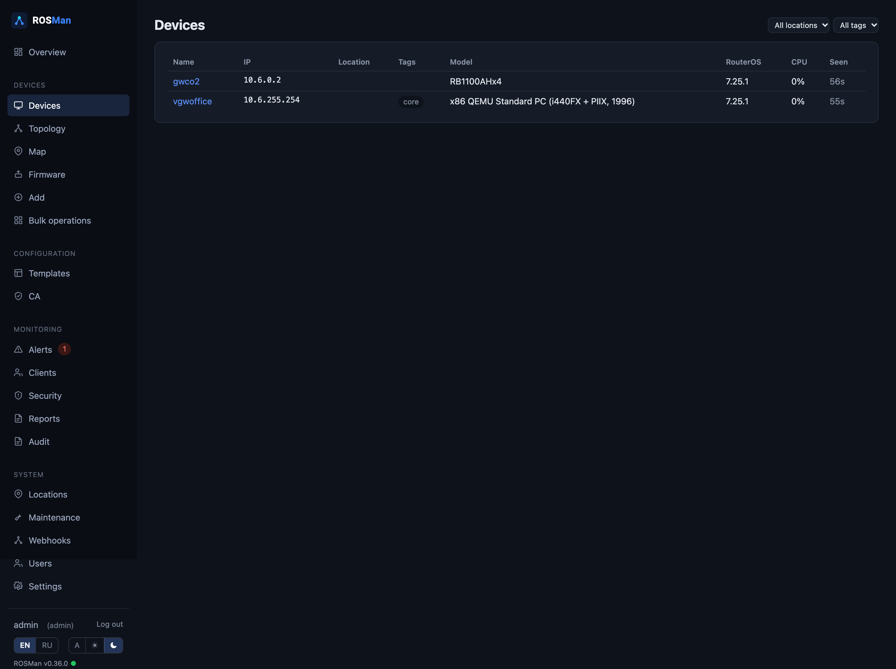
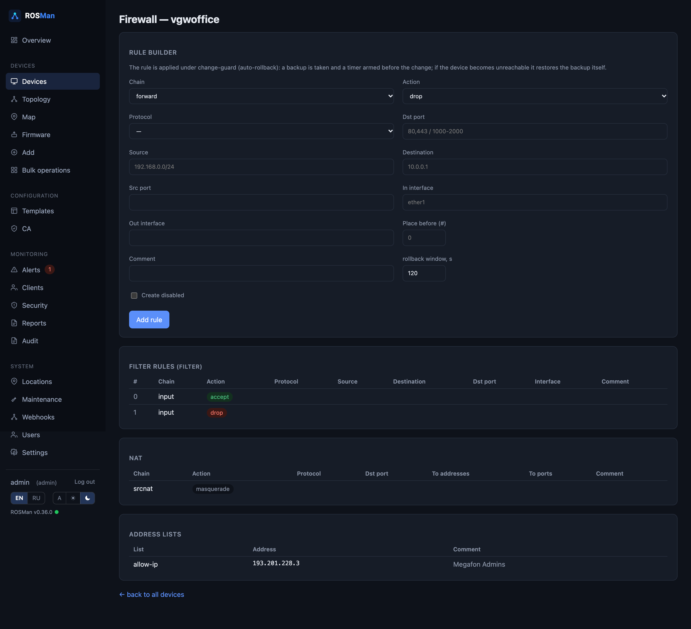
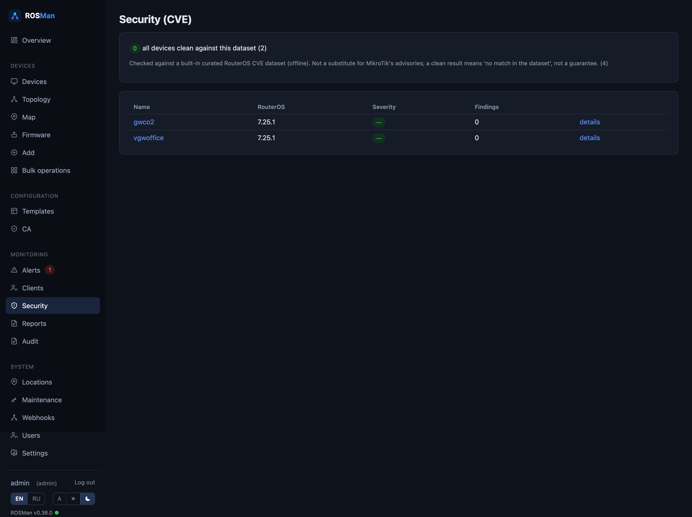

# ROSMan

**A lightweight fleet manager for MikroTik (RouterOS).** One Go binary + SQLite,
no external services. Original project — not affiliated with MikroTik.

The UI language is **English by default**, with Russian available in one click.
Localization lives in plain JSON files under
[`internal/i18n/locales`](internal/i18n/locales) (`en.json`, `ru.json`).



## Features

- **Inventory & onboarding** — add a device over API-SSL with trust-on-first-use
  certificate pinning; identity/model/serial/version read automatically. Bulk
  **import from CSV**.
- **Monitoring** — health polling (CPU/RAM/temperature/uptime), live load graphs
  with selectable ranges (6h/24h/7d/30d), device faceplate, interface traffic,
  connected clients (with OUI vendor lookup), LLDP/MNDP neighbours, topology map,
  and a **geographic map** (Leaflet) of geotagged locations.
- **Configuration** — `/export` + full binary backups over SSH, versioned by
  sha256, with **diff & rollback** under an auto-rollback change-guard; config
  templates; a **firewall viewer and rule builder**; scheduled **export to a git
  repository**.
- **Firmware & security** — update checks, canary-first fleet upgrades, an offline
  **CVE scanner** against RouterOS versions, and per-device **CA / api-ssl**
  certificate management.
- **Services** — read-only views of DNS/DHCP/NTP and classic **CAPsMAN**;
  per-device **ping & traceroute**; **LTE** signal metrics.
- **Operations** — **bulk operations** across selected devices (poll / backup /
  firmware check / apply template), **maintenance windows** that suppress alert
  notifications, and fleet **reports** (CSV + a printable PDF view).
- **Alerting & integrations** — device-down / firmware / certificate alerts via
  Telegram and email, outgoing **webhooks** (JSON, optional HMAC signatures), and
  a Prometheus **`/metrics`** endpoint.
- **Access & accounts** — roles (viewer / operator / admin), **TOTP 2FA**,
  personal **API tokens** with a read-only JSON API, user management, and an audit
  log.
- **Self-update indicator** — the version badge in the corner is green when you
  run the latest release and red (linking to the new release) when an update is
  available.

Credentials are encrypted at rest (AES-256-GCM); passwords are bcrypt-hashed.

## Build

```bash
go build -o rosman ./cmd/rosman
```

## Run

```bash
ROSMAN_SSH_KEY=~/.ssh/id_routeros ./rosman
```

On first start it creates a `./data` directory (database, encryption key,
self-signed TLS) and an `admin` user with a random password printed once to the
log. Open `https://<host>:8443` (accept the self-signed certificate warning).

## Environment variables

| Variable | Default | Purpose |
|---|---|---|
| `ROSMAN_LISTEN` | `:8443` | HTTPS listen address |
| `ROSMAN_DATA_DIR` | `./data` | data directory |
| `ROSMAN_SSH_KEY` | — | SSH private key for `/export` (backups disabled without it) |
| `ROSMAN_POLL_INTERVAL` | `2m` | health poll cadence |
| `ROSMAN_BACKUP_INTERVAL` | `12h` | config backup cadence |
| `ROSMAN_API_TIMEOUT` / `ROSMAN_SSH_TIMEOUT` | `15s` | timeouts |

## JSON API

Create a personal token under **Account**, then:

```bash
curl -k -H "Authorization: Bearer <token>" https://HOST:8443/api/v1/devices
```

Endpoints: `/api/v1/devices`, `/api/v1/devices/{id}`, `/api/v1/alerts`,
`/api/v1/security`, and `/metrics` (Prometheus, same bearer token).

## Screenshots

| Fleet | Firewall | Security (CVE) |
|---|---|---|
|  |  |  |

## Deployment

A ready-made systemd unit is in [`deploy/rosman.service`](deploy/rosman.service).

---

### Русский

ROSMan — лёгкий менеджер парка MikroTik (RouterOS): один Go-бинарник + SQLite, без
внешних сервисов. Интерфейс по умолчанию на английском, русский — в один клик
(локализация в JSON-файлах `internal/i18n/locales`). Полный список возможностей —
выше в английском разделе; архитектура и история — в [DESIGN.md](DESIGN.md).
